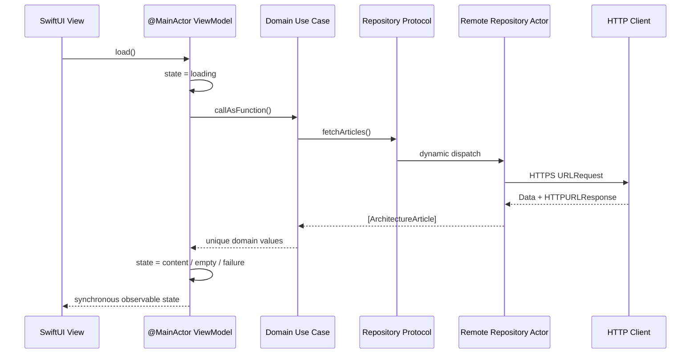

# Architecture

## Goal

Show one complete Swift 6 feature with enough boundaries to make architectural decisions reviewable, while keeping the repository small enough to understand in a single sitting.

The package is not a universal starter template. It is evidence for a way of reasoning: dependencies point inward, asynchronous work crosses typed contracts, UI state has one owner and concrete objects are composed at an explicit edge.

## Module graph

| Module | Owns | May depend on | Must not know |
| --- | --- | --- | --- |
| `ArchitectureDomain` | Entities, repository protocol, use-case rule | Swift standard library, Foundation value types | SwiftUI, URLSession, concrete storage |
| `ArchitectureData` | DTOs, validation, HTTPS request, concrete repositories | Domain, Foundation | Views, navigation, presentation copy |
| `ArchitectureFeature` | SwiftUI, ViewModel, state, Router | Domain, SwiftUI, Observation | Concrete networking or environment configuration |
| `ArchitectureComposition` | Demo/live object graphs | Domain, Data, Feature | Business rules or reusable UI |

Swift Package Manager enforces these arrows. A source file cannot import an outer module that is absent from its target dependencies.

## Request and state flow



Each layer translates errors into its own vocabulary:

- transport and decoding become `ArchitectureDataError`;
- duplicate domain identifiers become `ArchitectureDomainError`;
- implementation details become stable user-facing copy at the ViewModel boundary.

No raw server message reaches the UI.

## Concurrency model

- `ArchitectureArticle` and related values are immutable and `Sendable`.
- Repository protocols are `Sendable`, so implementations can safely cross isolation boundaries.
- `RemoteArchitectureArticleRepository` and `URLSessionHTTPClient` are actors because they own non-UI service state.
- `ArchitectureArticleListViewModel` and the Router are `@MainActor`, matching synchronous SwiftUI observation.
- The package does not introduce `Task.detached`, `@unchecked Sendable`, `nonisolated(unsafe)` or GCD queue hopping.
- The UI initiates lifecycle work with `.task`; retry ownership stays in the ViewModel through a synchronous entry point.

The objective is not maximum concurrency. It is a small number of clear isolation domains with immutable values between them.

## State model

`ArchitectureArticleListState` makes valid screen phases explicit:

```swift
enum ArchitectureArticleListState {
    case idle
    case loading
    case content([ArchitectureArticle])
    case empty
    case failure(message: String)
}
```

This prevents a view from inferring state from combinations such as `items.isEmpty`, `isLoading` and `error != nil`. Search text remains presentation state, while filtering is a ViewModel concern rather than a domain rule.

## Navigation model

`ArchitectureRouter` owns a typed `[ArchitectureRoute]` path. Feature rows ask a protocol to navigate; they do not mutate `NavigationPath`, parse strings or construct destinations. The root view binds the Router to `NavigationStack` and resolves destinations in one place.

For a larger app, the same seam can add URL-to-route parsing, state restoration or a parent coordinator without changing the domain and data layers.

## Composition

`ArchitectureReference` is the composition root:

- `demo()` injects fixed first-party content for deterministic previews and evaluation;
- `live(baseURL:)` injects the actor-isolated HTTPS implementation.

No singleton or service locator is needed. A production app can read environment configuration in its app target and pass a base URL into the live graph.

## Test shape

| Boundary | What the tests prove |
| --- | --- |
| Domain | Repository results pass through and duplicate identifiers fail deterministically |
| Data mapping | Whitespace normalization, enum validation and reading-time constraints |
| Endpoint | HTTPS-only transport, path, method, timeout and Accept header |
| Remote repository | Success decoding, status handling and stable decoding errors |
| Presentation | Content, empty, failure copy, localized search and Router delegation |

Tests use Swift Testing in the package host, run in parallel by default and do not launch an app or simulator. Test doubles are injected through the same protocols used by the production graph.

## Scaling guidance

Add a module when it protects a real ownership or build boundary, not when a folder becomes visually busy.

- Multiple independent features can each own a Feature target while sharing focused Domain capabilities.
- Persistence can implement the domain repository beside or instead of the remote repository.
- A caching decorator can wrap repositories without changing the use case.
- A parent composition root can assemble account, feature flag or environment dependencies.
- Cross-feature navigation belongs above individual feature Routers.

Keep the current shape when the product is small. Splitting every model, use case or screen into its own package would trade one kind of coupling for build and maintenance overhead.

## Rejected alternatives

| Alternative | Why it is not used here |
| --- | --- |
| One app target with folders only | Easier initially, but it cannot prove dependency direction at compile time |
| Global service locator | Hides object lifetime and makes tests depend on mutable global state |
| Third-party DI container | No object graph here is complex enough to justify another runtime or supply-chain dependency |
| Actor ViewModel | SwiftUI needs synchronous observable state on MainActor |
| `ObservableObject` + Combine | Observation is sufficient for an iOS 18+ reference and removes publisher boilerplate |
| TCA | Strong option for different constraints, but unnecessary for one small vertical slice |
| Generic base repositories/ViewModels | Abstracts names while hiding the product-specific contract the reviewer needs to see |

## Decision records

- [ADR-0001: protect dependency direction](docs/decisions/0001-protect-dependency-direction.md)
- [ADR-0002: isolate observable state on MainActor](docs/decisions/0002-mainactor-observable-state.md)
- [ADR-0003: compose concrete dependencies at one edge](docs/decisions/0003-explicit-composition-root.md)

