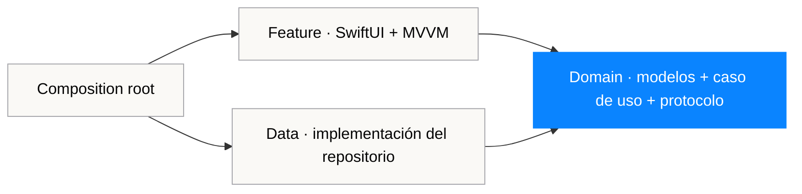

# Referencia de arquitectura iOS


[](Package.swift)
[](Package.swift)
[](https://github.com/magnoscg/ios-architecture-reference/actions/workflows/ci.yml)
[](LICENSE.md)

**[English](README.md)** · **[Arquitectura](ARCHITECTURE.md)** · **[Decisiones](docs/decisions)** · **[Seguridad](SECURITY.md)**

Una referencia pequeña y compilable en Swift 6 para **Clean Architecture + MVVM + navegación Router tipada**. Es deliberadamente más acotada que una app de producción: una vertical completa, cuatro módulos, reglas de dependencia explícitas y tests rápidos sin lanzar un simulador.

Es una implementación original de Oscar Canton. No contiene código de producto de CholloGas o Hilo, credenciales, endpoints de producción ni detalles privados de infraestructura.

## Resumen para recruiters

| Señal | Evidencia |
| --- | --- |
| Arquitectura | Cuatro targets Swift Package con dirección de dependencias comprobada al compilar |
| iOS moderno | Swift 6, SwiftUI, Observation, async/await y límites `Sendable` |
| Presentación | Estados loading/content/empty/failure explícitos y ViewModel `@MainActor` |
| Navegación | Rutas tipadas controladas por un Router observable fuera de las vistas de feature |
| Entrega | Un composition root para grafos demo y live |
| Calidad | 15 pruebas Swift Testing sobre dominio, datos y presentación |
| Supply chain | Cero paquetes de terceros y permisos de CI de solo lectura |

## Qué demuestra el repositorio



Las flechas representan dependencias, no llamadas en runtime. `ArchitectureDomain` no importa SwiftUI ni networking. `ArchitectureData` implementa el protocolo definido por dominio. `ArchitectureFeature` consume el caso de uso y solo posee estado de presentación. `ArchitectureComposition` es el único punto que conoce todos los tipos concretos.

El flujo de ejecución también es explícito:

```text
Tarea SwiftUI
  → ViewModel @MainActor
    → caso de uso de dominio
      → protocolo de repositorio
        → repositorio remoto aislado en actor
          → cliente HTTPS
        ← valores de dominio Sendable
    ← estado content / empty / failure
  → destino Router tipado
```

## Revísalo en cinco minutos

1. Empieza por [`Package.swift`](Package.swift) para ver el grafo de módulos.
2. Lee [`LoadArchitectureArticles`](Sources/ArchitectureDomain/LoadArchitectureArticles.swift) para ver una regla de dominio sin frameworks.
3. Compara el protocolo con [`RemoteArchitectureArticleRepository`](Sources/ArchitectureData/RemoteArchitectureArticleRepository.swift).
4. Revisa [`ArchitectureArticleListViewModel`](Sources/ArchitectureFeature/ArchitectureArticleListViewModel.swift) para ver estado MainActor y traducción de errores.
5. Termina en [`ArchitectureReference`](Sources/ArchitectureComposition/ArchitectureReference.swift), donde las dependencias concretas se componen una sola vez.

## Compilar y validar

Requisitos: Xcode 16 o posterior con toolchain Swift 6.

```bash
swift test
swift build -c release
./scripts/validate-public-content.sh
```

El package tiene target iOS 18+ y usa macOS 15+ como host rápido de tests. Las pruebas unitarias usan Swift Testing y no necesitan simulador iOS.

## Usar la referencia desde un app shell mínimo

Añade el package localmente y deja que el target de la app sea responsable únicamente del arranque de plataforma y la configuración de producción:

```swift
import ArchitectureComposition
import SwiftUI

@main
struct ReferenceDemoApp: App {
    var body: some Scene {
        WindowGroup {
            ArchitectureReference.demo()
        }
    }
}
```

`ArchitectureReference.live(baseURL:)` muestra el mismo grafo con repositorio HTTPS. El grafo demo es determinista para que previews y builds exploratorias no dependan de un backend.

## Trade-offs deliberados

- Es una referencia, no un framework que un equipo deba adoptar sin debatirlo.
- Cuatro módulos hacen visible la regla de dependencias; una app menor puede necesitar menos.
- El Router aporta valor porque la navegación forma parte del ejemplo. Una vista hoja sencilla no lo necesita.
- El cliente de red está aislado en actor; los payloads inmutables cruzan límites como valores `Sendable`.
- Los errores se convierten en copy estable de presentación en el límite de feature; no se filtran detalles de transporte.
- No se añaden persistencia, analítica, autenticación ni una librería de inyección solo para agrandar el diagrama.

El razonamiento completo, alternativas descartadas y guía de escalado están en [`ARCHITECTURE.md`](ARCHITECTURE.md) y los [registros de decisiones](docs/decisions).

## Límite del repositorio

El dominio de ejemplo describe artículos de arquitectura creados para este repositorio. No está extraído de una aplicación comercial. El código de producto, las credenciales y la configuración operativa permanecen fuera de este repositorio por diseño. Consulta [`SECURITY.md`](SECURITY.md) para la postura pública y [`ASSET_PROVENANCE.md`](ASSET_PROVENANCE.md) para la procedencia de marca.

---

<a href="https://ogamlabs.com"></a>

Creado por [Oscar Canton](https://github.com/magnoscg) · [Licencia MIT](LICENSE.md)
