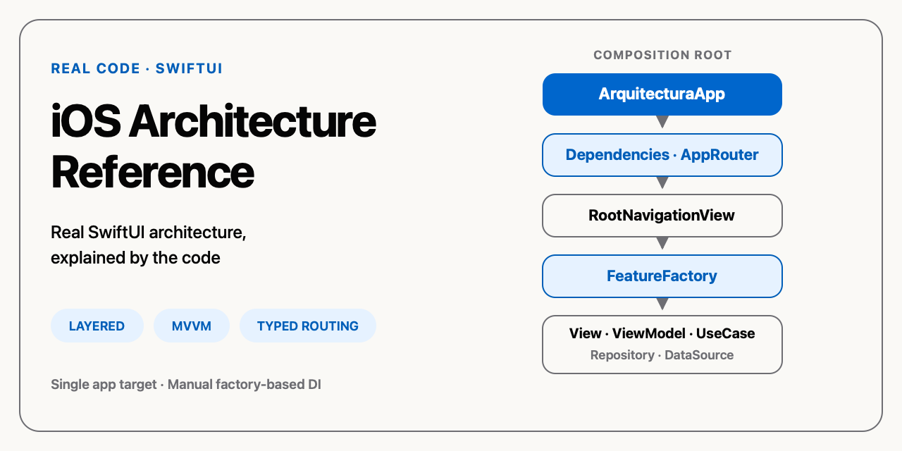
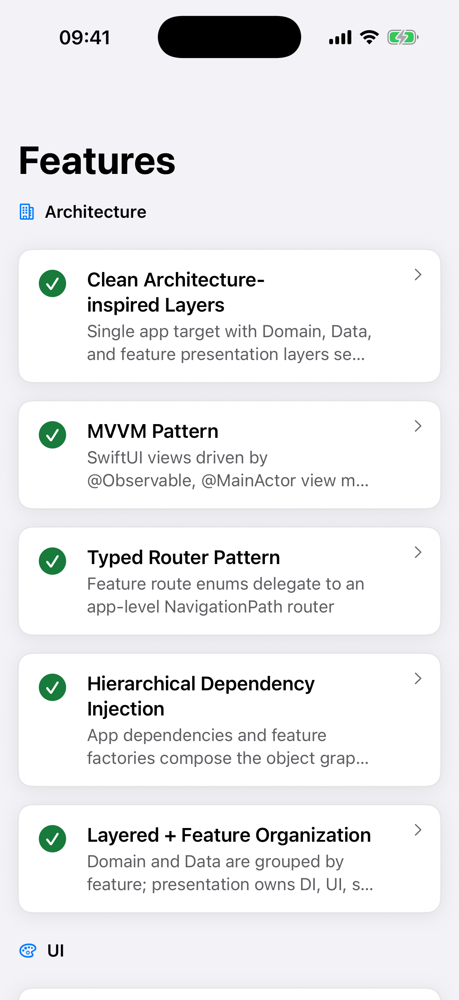
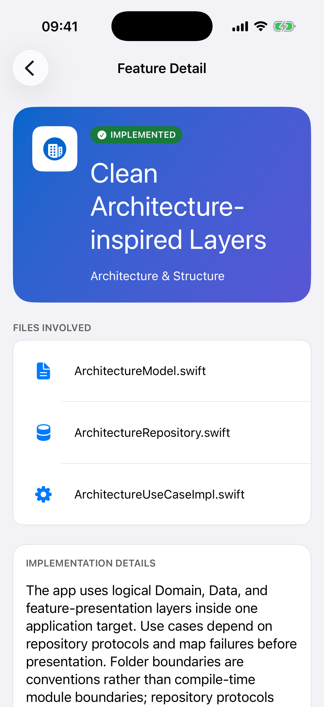
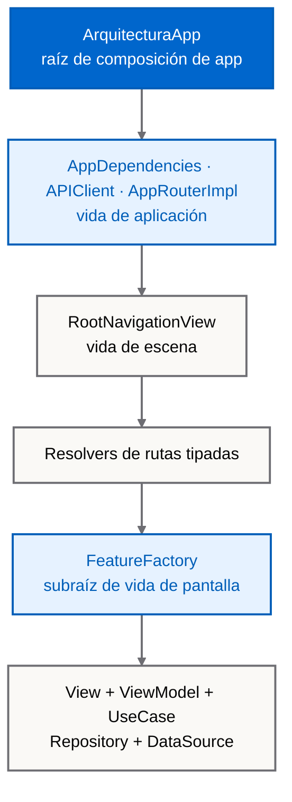
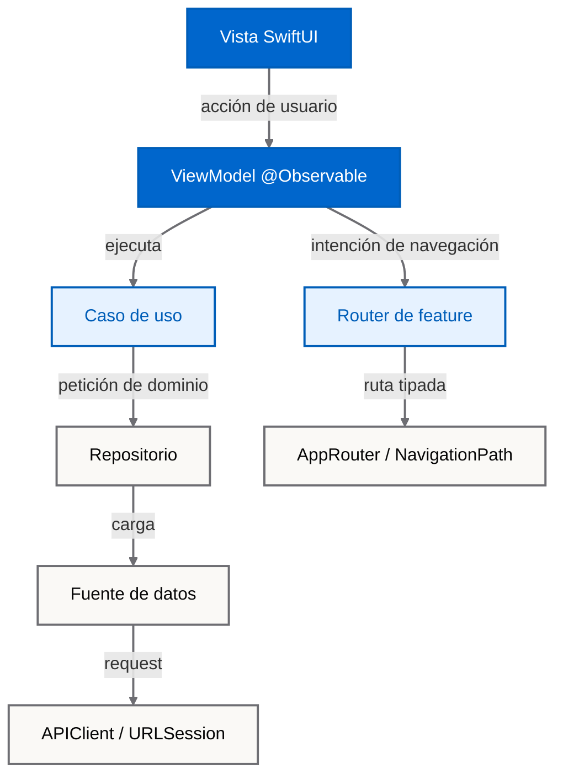

# Referencia de arquitectura iOS



[](Arquitectura.xcodeproj/project.pbxproj)
[](Arquitectura.xcodeproj/project.pbxproj)
[](https://github.com/magnoscg/ios-architecture-reference/actions/workflows/ci.yml)
[](LICENSE.md)

**[English](README.md)** · **[Arquitectura](ARCHITECTURE.es.md)** · **[Estructura](docs/PROJECT-STRUCTURE.es.md)** · **[Limitaciones](docs/KNOWN-LIMITATIONS.es.md)**

Una aplicación SwiftUI compilable que muestra la arquitectura que Oscar Canton utiliza como referencia en sus proyectos iOS: **organizada por capas y features, inspirada en Clean Architecture, con MVVM, navegación tipada e inyección manual mediante factories**.

Es la aplicación de referencia real, no una muestra construida solo para sostener un diagrama. Se publica deliberadamente sin código privado de producto, historial del repositorio privado, credenciales ni infraestructura operativa.

## Evidencia de la aplicación real

Estas capturas proceden de la app `Arquitectura-Dev` incluida, ejecutada en un simulador iPhone 17 Pro con iOS 26.5. Cada imagen responde automáticamente al tema claro/oscuro de GitHub; las dos variantes se pueden revisar directamente en [`docs/images`](docs/images).

<p align="center">
  <picture>
    <source media="(prefers-color-scheme: dark)" srcset="docs/images/architecture-list-dark.png">
    
  </picture>
  <picture>
    <source media="(prefers-color-scheme: dark)" srcset="docs/images/architecture-detail-dark.png">
    
  </picture>
</p>

La galería usa locale `en_US` y no contiene arte de Pokémon. Las condiciones de captura y hashes inmutables están en [Procedencia de assets](ASSET_PROVENANCE.md).

## Qué puede verificar quien la revise

- **Composición trazable:** [`ArquitecturaApp`](Arquitectura/ArquitecturaApp.swift) crea las dependencias de vida de aplicación; cada factory construye el grafo de vida de pantalla.
- **Flujos completos:** vista SwiftUI → ViewModel `@Observable` → caso de uso → repositorio → fuente de datos → `APIClient`.
- **Navegación tipada:** enums de ruta por feature delegan en un único [`AppRouter`](Arquitectura/App/Navigation/AppRouter.swift) observable.
- **Problemas reales de entrega:** entornos xcconfig, networking con URLSession, interceptores, infraestructura de SSL pinning, manifiesto de privacidad, deep links y restauración de rutas.
- **Evidencia de tests:** el snapshot verificado el 04-08-2026 ejecuta 194 casos Swift Testing en 27 suites. CI calcula el recuento vigente en vez de confiar en esta frase.
- **Límites honestos:** las carpetas expresan la arquitectura dentro de un target de aplicación; no imponen límites de módulo al compilar.

## Composición y ciclos de vida



Alternativa textual:

```text
ArquitecturaApp
├── AppDependencies ── APIClient                 [vida de aplicación]
├── AppRouterImpl                                [vida de aplicación]
└── RootNavigationView                           [vida de escena]
    └── resolvers de rutas tipadas
        └── FeatureFactory                       [vida de pantalla]
            └── View · ViewModel · UseCase · Repository · DataSource
```

La aplicación tiene una **raíz de composición jerárquica**, no un único archivo global que construye todos los tipos concretos. La raíz de app posee servicios compartidos y navegación; las factories son raíces menores para cada pantalla.

## Flujo en ejecución



Alternativa textual:

```text
View → ViewModel → UseCase → Repository → DataSource → APIClient
          └──────→ FeatureRouter → AppRouter → NavigationPath
```

Estas flechas representan colaboración en runtime. Como todo el código de app se compila en un único target, los límites entre capas son convenciones protegidas por revisión y tests, no módulos Swift separados.

## Revísala en cinco minutos

1. Empieza en [`ArquitecturaApp`](Arquitectura/ArquitecturaApp.swift) y [`AppDependencies`](Arquitectura/App/Config/AppDependencies.swift) para ver la construcción de vida de aplicación.
2. Sigue [`RootNavigationView`](Arquitectura/App/Navigation/RootNavigationView.swift) hasta los resolvers de rutas tipadas.
3. Abre [`PokemonListFactory`](Arquitectura/Features/PokemonList/DI/PokemonListFactory.swift) para inspeccionar un grafo completo de feature.
4. Recorre [`PokemonListViewModel`](Arquitectura/Features/PokemonList/Presentation/ViewModels/PokemonListViewModel.swift) → [`PokemonListUseCaseImpl`](Arquitectura/Domain/PokemonList/UseCases/PokemonListUseCaseImpl.swift) → [`PokemonListRepositoryImpl`](Arquitectura/Data/PokemonList/Repositories/PokemonListRepositoryImpl.swift).
5. Compara esos contratos con sus tests en [`ArquitecturaTests`](ArquitecturaTests).

La aplicación también contiene un catálogo local de arquitectura con 19 entradas implementadas. Cada detalle enlaza con rutas reales de este repositorio; los conceptos inexistentes se han eliminado en vez de presentarlos como trabajo terminado.

## Compilar y validar

Requisitos:

- macOS con el formato de proyecto de Xcode 26.2. El snapshot se verificó localmente con Xcode 26.6 y compilador Swift 6.3.3; CI usa el Xcode predeterminado de la imagen `macos-26` de GitHub.
- Un simulador iOS 18 o posterior.
- SwiftFormat y SwiftLint disponibles en `PATH` para validar estilo.

```bash
git clone https://github.com/magnoscg/ios-architecture-reference.git
cd ios-architecture-reference
make ci
open Arquitectura.xcodeproj
```

Selecciona el scheme compartido `Arquitectura-Dev` y un simulador iPhone disponible. Development es el único entorno validado como ejecutable en esta referencia pública.

Comandos útiles:

```bash
make build      # Compila Arquitectura-Dev sin firma
make test       # Ejecuta el test plan Swift Testing en simulador
make lint       # Comprueba SwiftFormat y SwiftLint sin reescribir archivos
make validate   # Valida límite público, enlaces y procedencia
make format     # Reescribe formato Swift de manera explícita
```

## Qué es este repositorio — y qué no es

El proyecto demuestra la arquitectura con dos dominios pequeños: un catálogo local que se documenta a sí mismo y un flujo real de listado/detalle sobre PokeAPI. No tiene paquetes Swift de terceros.

No es **Clean Architecture estricta**, un framework reutilizable, una app offline-first ni un target de producción listo para App Store. En concreto:

- los protocolos de repositorio viven hoy bajo `Data`, aunque los consuman casos de uso de Domain;
- el único target de app no puede impedir imports entre capas;
- Staging y Production son plantillas ilustrativas con configuración placeholder;
- el test plan incluido ejecuta suites Swift Testing unitarias y de integración, no UI tests;
- no existe una base de datos ni persistencia de datos de dominio.

Consulta [Limitaciones conocidas](docs/KNOWN-LIMITATIONS.es.md) para ver la lista completa y priorizada.

## Mapa de documentación

- [Arquitectura](ARCHITECTURE.es.md): límites, composición, navegación, estado, errores, concurrencia y tests.
- [Estructura](docs/PROJECT-STRUCTURE.es.md): árbol real y guía para colocar archivos.
- [Decisiones de arquitectura](docs/decisions): decisiones actuales y registros históricos de v1.
- [Procedencia del código](docs/SOURCE-PROVENANCE.md): snapshot reproducible y allowlist pública.
- [Referencia SPM v1](docs/V1-SPM-REFERENCE.md): package conservado y nota de migración.
- [Seguridad](SECURITY.md) y [avisos de terceros](THIRD_PARTY_NOTICES.md).

## Límites de versión y licencia

La versión 2 rompe compatibilidad al pasar de un Swift Package con cuatro targets a esta aplicación Xcode de referencia. El package original sigue disponible en el tag [`1.0.0`](https://github.com/magnoscg/ios-architecture-reference/tree/1.0.0).

El código fuente del repositorio se ofrece bajo [licencia MIT](LICENSE.md). La identidad de OgamLabs y los nombres, datos y recursos de terceros quedan fuera de esa licencia de código; consulta [procedencia de assets](ASSET_PROVENANCE.md) y [avisos de terceros](THIRD_PARTY_NOTICES.md).

---

Creado por [Oscar Canton](https://github.com/magnoscg) bajo la identidad de estudio [OgamLabs](https://ogamlabs.com).

**Metadatos del documento**

| Campo | Valor |
| --- | --- |
| Autor / Responsable | magnoscg / OgamLabs |
| Última actualización | 2026-08-04 |
| Última verificación | 2026-08-04 |
| Estado | Verificado para el snapshot v2 |
| Revisión | Trimestral y con cada cambio arquitectónico |
| Etiquetas | `ios`, `swiftui`, `arquitectura`, `referencia` |
