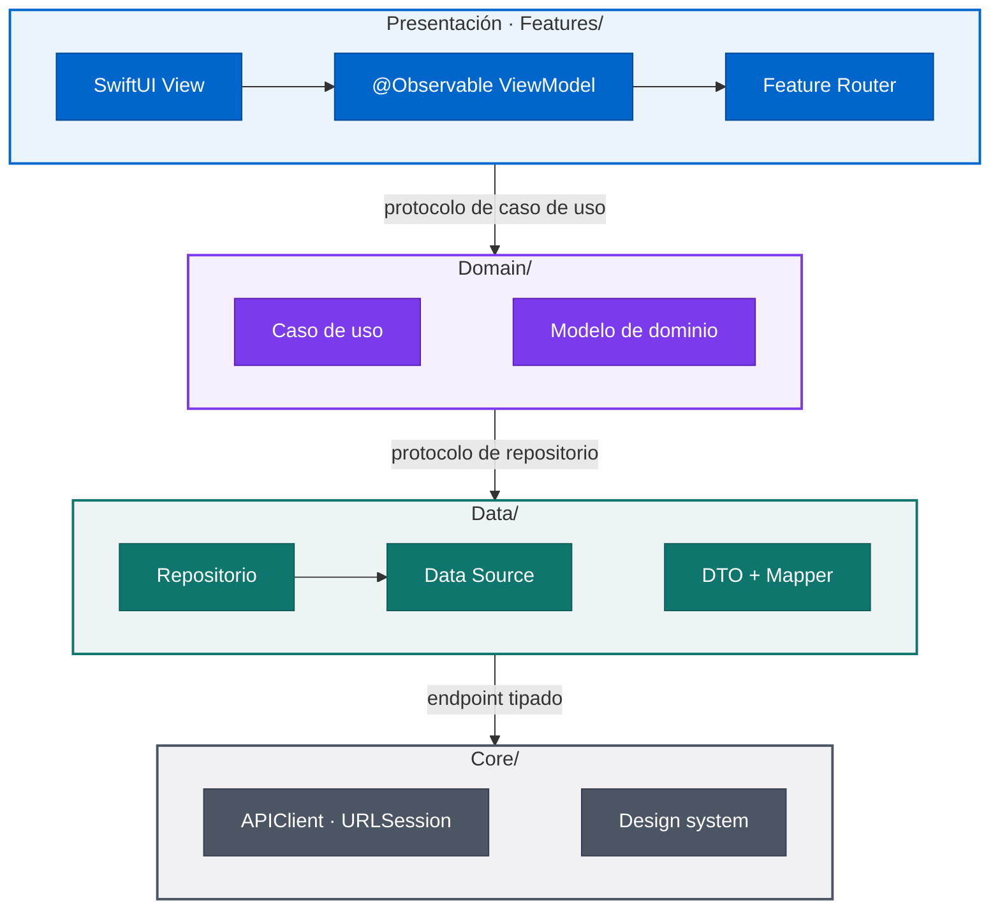
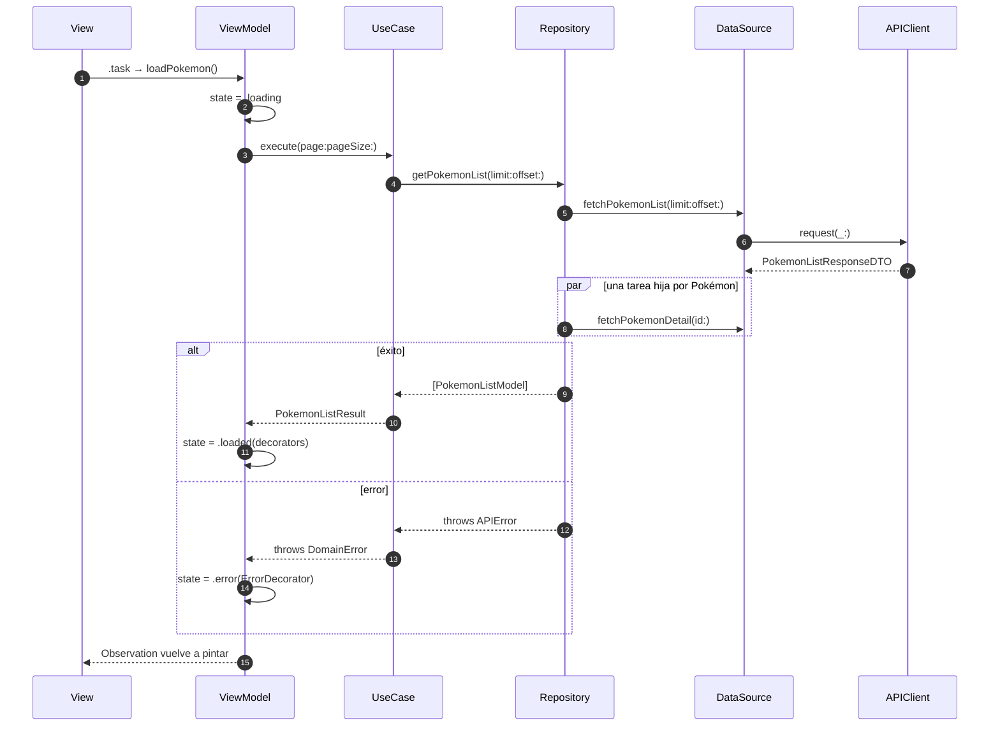
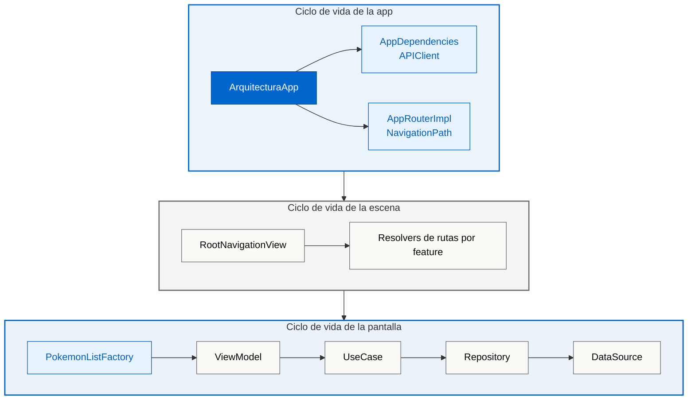

<div align="center">


**Una app SwiftUI real y compilable que muestra cómo estructuro mis proyectos iOS:**<br>
**arquitectura por capas, MVVM, navegación tipada e inyección de dependencias manual, en Swift 6.**

[](Arquitectura.xcodeproj/project.pbxproj)
[](Arquitectura.xcodeproj/project.pbxproj)
[](Arquitectura/Features)
[](ArquitecturaTests)
[](https://github.com/magnoscg/ios-architecture-reference/actions/workflows/ci.yml)
[](Arquitectura.xcodeproj/project.pbxproj)
[](LICENSE.md)

[**Arquitectura**](#-arquitectura) · [**Vida de una petición**](#-vida-de-una-petición) · [**Decisiones de diseño**](#-decisiones-de-diseño) · [**Ejecútalo**](#-puesta-en-marcha) · [**Sobre mí**](#-sobre-mí) · [**English**](README.md)

</div>

## ✨ Lo más destacado

<table>
<tr>
<td width="33%" valign="top">

**🧱 Por capas y por feature**

`Domain`, `Data` y `Features` se dividen por feature, y los mappers protegen cada frontera: DTO → modelo → decorator de UI.

</td>
<td width="33%" valign="top">

**🧭 Navegación tipada**

Cada feature define su enum de rutas `Codable`. Un único `NavigationPath` gobierna la app, con deep links y restauración de estado.

</td>
<td width="33%" valign="top">

**🧩 DI sin contenedor**

Servicios de app más una factory por pantalla. Cada grafo de objetos se lee de arriba abajo y lo comprueba el compilador.

</td>
</tr>
<tr>
<td width="33%" valign="top">

**⚡ Concurrencia Swift 6**

Modo de lenguaje Swift 6, ViewModels `@MainActor`, task groups, `async let` y una cancelación que nunca se silencia.

</td>
<td width="33%" valign="top">

**🧪 194 tests**

27 suites de Swift Testing que replican el árbol de código: mappers, repositorios, casos de uso, ViewModels y navegación.

</td>
<td width="33%" valign="top">

**📦 Cero dependencias**

Solo frameworks de Apple, incluido un cliente `URLSession` con cadena de interceptores, reintentos con backoff y soporte de SSL pinning.

</td>
</tr>
</table>

## 📱 La app

<p align="center">
  
  
  
  
</p>

La app se documenta a sí misma. Un catálogo dentro de la app explica **19 patrones** (arquitectura, UI, networking, seguridad y testing), y cada uno apunta a los ficheros reales que lo implementan. Un segundo flujo habla con **[PokeAPI](https://pokeapi.co)**: un listado paginado con scroll infinito y una pantalla de detalle que ejercitan networking, concurrencia y gestión de errores de punta a punta. Modo claro y oscuro, en inglés y en español.

## 🧱 Arquitectura

El proyecto está **organizado por capas a nivel global y por feature a nivel local**. Cada capa habla con la siguiente a través de un protocolo, así que las Views nunca ven un repositorio y los ViewModels nunca ven un DTO.



| Capa | Responsabilidad | Ejemplo |
| --- | --- | --- |
| **App** | Arranque, raíz de composición, pila de navegación y deep links | [`ArquitecturaApp`](Arquitectura/ArquitecturaApp.swift) |
| **Features** | Vistas SwiftUI, enums de estado, ViewModels, mappers de UI, routers y factories | [`PokemonListViewModel`](Arquitectura/Features/PokemonList/Presentation/ViewModels/PokemonListViewModel.swift) |
| **Domain** | Modelos de negocio y casos de uso | [`PokemonListUseCaseImpl`](Arquitectura/Domain/PokemonList/UseCases/PokemonListUseCaseImpl.swift) |
| **Data** | Repositorios, data sources, DTOs y sus mappers | [`PokemonListRepositoryImpl`](Arquitectura/Data/PokemonList/Repositories/PokemonListRepositoryImpl.swift) |
| **Core** | Networking, utilidades de seguridad, design system y componentes compartidos | [`APIClientImpl`](Arquitectura/Core/Networking/APIClientImpl.swift) |

Los datos se traducen en cada frontera (`DTO → modelo` en Data, `modelo → decorator` en Presentación) y los errores siguen el mismo camino: `APIError → DomainError → ErrorDecorator`. Las respuestas crudas del servidor nunca llegan a la UI.

## 🔄 Vida de una petición

Qué ocurre cuando se abre el listado de Pokémon:



Los detalles se piden en paralelo con un task group. Si falla un detalle concreto, se registra y se omite para que no rompa la página; la cancelación, en cambio, siempre se propaga.

## 🧩 Dentro de una feature

Todas las features siguen la misma forma, así que una pantalla nueva es predecible de construir y fácil de revisar:

```text
Features/PokemonList/
├── DI/PokemonListFactory.swift            construye el grafo de objetos de la pantalla
├── Navigation/
│   ├── PokemonListRouter.swift            enum de rutas + protocolo router + impl
│   └── PokemonListRouteResolver.swift     ruta → vista de destino
├── Presentation/
│   ├── Mappers/                           modelo de dominio → decorator de UI
│   └── ViewModels/PokemonListViewModel.swift
└── UI/
    ├── PokemonListView.swift
    ├── PokemonListState.swift             idle · loading · loaded · error
    ├── PokemonListDecorator.swift
    └── Components/
Domain/PokemonList/                        Models/ · UseCases/
Data/PokemonList/                          Repositories/ · DataSources/ · DTO/ · Mappers/
```

Cada pantalla pinta un único estado explícito, así que las combinaciones imposibles no se pueden expresar:

```swift
enum PokemonListState: Equatable {
    case idle
    case loading
    case loaded([PokemonListItemDecorator])
    case error(ErrorDecorator)
}
```

**La inyección de dependencias es manual y jerárquica.** La raíz de la app crea una sola vez los servicios de larga vida; la factory de cada pantalla monta su propio grafo con inyección por constructor. Sin contenedor, sin service locator y sin singletons.



<details>
<summary><b>Ver la factory</b></summary>

De [`PokemonListFactory.swift`](Arquitectura/Features/PokemonList/DI/PokemonListFactory.swift):

```swift
static func makeView(appRouter: AppRouter, dependencies: AppDependencies) -> PokemonListView {
    let router = makeRouter(appRouter: appRouter)
    let viewModel = makeViewModel(router: router, apiClient: dependencies.apiClient)
    return PokemonListView(viewModel: viewModel)
}

static func makeRepository(apiClient: APIClient) -> PokemonListRepository {
    PokemonListRepositoryImpl(remoteDataSource: makeRemoteDataSource(apiClient: apiClient),
                              dtoMapper: makeDTOMapper())
}

static func makeUseCase(apiClient: APIClient) -> PokemonListUseCase {
    PokemonListUseCaseImpl(repository: makeRepository(apiClient: apiClient))
}

static func makeViewModel(router: PokemonListRouter, apiClient: APIClient) -> PokemonListViewModel {
    PokemonListViewModel(useCase: makeUseCase(apiClient: apiClient),
                         decoratorMapper: makeDecoratorMapper(),
                         router: router)
}
```

</details>

## 🧭 Navegación

Ni las vistas de las features ni sus ViewModels construyen pantallas ni tocan el path de navegación. Cada feature declara sus rutas como un enum `Codable` detrás de un pequeño protocolo router, de modo que un ViewModel solo expresa intención:

```swift
enum PokemonListRoute: Hashable, Codable {
    case list
    case detail(pokemonId: Int)
}

@MainActor
protocol PokemonListRouter: Sendable {
    func navigateToDetail(pokemonId: Int)
    func goBack()
}
```

Un único `NavigationStack` es dueño del path, y cada feature registra sus destinos con un modifier resolver:

```swift
NavigationStack(path: $appRouter.path) {
    ArchitectureFactory.makeView(appRouter: appRouter)
        .withArchitectureRoutes(appRouter: appRouter)
        .withPokemonListRoutes(appRouter: appRouter, dependencies: dependencies)
}
.onOpenURL { url in
    coordinator.handleDeepLink(url)
}
```

Como las rutas son `Codable`, el path se guarda con `@SceneStorage` (con debounce) y se restaura al relanzar la app, y los deep links `arquitectura://` se traducen directamente a rutas tipadas.

## ⚡ Concurrencia y errores

- **Modo de lenguaje Swift 6** con `MainActor` como aislamiento por defecto; los contratos que cruzan fronteras entre tareas son `Sendable`.
- **Concurrencia estructurada**: el listado pide los detalles en paralelo con `withThrowingTaskGroup`, y el detalle carga los datos y la especie a la vez con `async let`.
- **La cancelación es un camino de código real**: casos de uso y repositorios relanzan `CancellationError`, y los ViewModels restauran su estado anterior en lugar de quedarse atascados en un spinner.
- **Paginación resiliente**: el scroll infinito mantiene en pantalla el contenido ya cargado y muestra un banner con reintento cuando falla la siguiente página.

<details>
<summary><b>Ver cómo carga su estado un ViewModel</b></summary>

De [`PokemonListViewModel.swift`](Arquitectura/Features/PokemonList/Presentation/ViewModels/PokemonListViewModel.swift):

```swift
func loadPokemon() async {
    switch state {
    case .loading, .loaded: return
    case .idle, .error: break
    }

    let previousState = state
    state = .loading
    currentPage = 0
    hasMore = true
    allItems = []

    do {
        let result = try await useCase.execute(page: 0, pageSize: pageSize)
        let items = decoratorMapper.mapToItems(result.pokemon)
        allItems = items
        hasMore = result.hasMore
        currentPage = 1
        state = .loaded(items)
    } catch is CancellationError {
        state = previousState
    } catch let error as DomainError {
        state = .error(ErrorDecorator.from(error))
    } catch {
        state = .error(.generic)
    }
}
```

</details>

## 🧪 Tests

**194 tests en 27 suites**, escritos con Swift Testing y organizados igual que la app (`App`, `Core`, `Domain`, `Data`, `Features`). Cada colaborador vive detrás de un protocolo, así que cada capa se prueba de forma aislada con mocks ligeros:

```swift
@Test("loadPokemon restores previous state on CancellationError")
func loadPokemonRestoresPreviousStateOnCancellation() async {
    let mockUseCase = MockPokemonListUseCase()
    await mockUseCase.setExecuteResult(.failure(CancellationError()))
    let (viewModel, _, _) = makeSUT(useCase: mockUseCase)

    await viewModel.loadPokemon()

    #expect(viewModel.state == .idle)
}
```

Las suites cubren endpoints e interceptores, mappers de DTO y de decorators, repositorios y data sources, la paginación, la ordenación, el mapeo de errores y la cancelación en los casos de uso, las transiciones de estado de los ViewModels, la delegación en los routers, y la codificación, la restauración y el parseo de deep links de la navegación.

[GitHub Actions](https://github.com/magnoscg/ios-architecture-reference/actions/workflows/ci.yml) se ejecuta en pushes y pull requests: validación de contenido → SwiftFormat y SwiftLint estricto → build → tests → comprobación de diff limpio.

## 🧠 Decisiones de diseño

La arquitectura es un conjunto de compromisos, así que los importantes están por escrito:

| Decisión | Por qué | Coste que asumo |
| --- | --- | --- |
| **Un solo target de app con capas lógicas** · [ADR-0004](docs/decisions/0004-single-app-target-logical-boundaries.md) | Fácil de abrir, compilar y recorrer; los módulos llegarán cuando los tiempos de compilación o la propiedad por equipos lo justifiquen | Las reglas entre capas se garantizan por convención, revisión y tests, no por el compilador |
| **Raíces de composición jerárquicas y escritas a mano** · [ADR-0005](docs/decisions/0005-hierarchical-composition-roots.md) | Ciclos de vida explícitos y grafos de objetos que comprueba el compilador, sin framework de DI | Unas pocas líneas más por feature |
| **Rutas tipadas por feature detrás de un único router de app** · [ADR-0006](docs/decisions/0006-typed-feature-routing.md) | Los ViewModels siguen siendo testeables y ajenos a la navegación de SwiftUI; las rutas `Codable` permiten restauración y deep links | Un `NavigationPath` compartido necesita un plan de migración si cambian las rutas guardadas |
| **ViewModels `@MainActor @Observable` con enums de estado explícitos** | Estado de UI predecible sin Combine y transiciones fáciles de testear | El trabajo se queda en el main actor salvo que se saque de él explícitamente |

Cada atajo conocido, incluido dónde se queda deliberadamente antes de una Clean Architecture estricta, está en [Limitaciones conocidas](docs/KNOWN-LIMITATIONS.es.md).

## 🧰 Stack técnico

| Área | Qué usa |
| --- | --- |
| Lenguaje y UI | Swift 6 · SwiftUI · Observation (`@Observable`) |
| Navegación | `NavigationStack` · rutas `Codable` tipadas · deep links · restauración con `@SceneStorage` |
| Networking | `URLSession` · endpoints tipados · interceptores de logging y reintento · delegate de SSL pinning · `NWPathMonitor` |
| Seguridad y privacidad | Helper de Keychain · privacy manifest |
| Localización | String Catalog en inglés y español |
| Configuración | Entornos `.xcconfig` con esquemas Development, Staging y Production |
| Calidad | Swift Testing · SwiftLint · SwiftFormat · GitHub Actions |
| Dependencias | Ninguna: solo frameworks de Apple |

## 🚀 Puesta en marcha

**Requisitos:** Xcode 26, un simulador con iOS 18 o superior, y SwiftLint y SwiftFormat para el lint (`brew install swiftlint swiftformat`).

```bash
git clone https://github.com/magnoscg/ios-architecture-reference.git
cd ios-architecture-reference
open Arquitectura.xcodeproj
```

Ejecuta el esquema **Arquitectura-Dev** en cualquier simulador de iPhone. Desde la terminal:

| Comando | Qué hace |
| --- | --- |
| `make build` | Compila la app de Development sin firma de código |
| `make test` | Ejecuta el plan de Swift Testing en un simulador |
| `make lint` | Comprueba SwiftFormat y SwiftLint sin modificar ficheros |
| `make validate` | Comprueba los enlaces de la documentación, los assets y la frontera pública |
| `make ci` | Ejecuta, en orden, todo lo que ejecuta la CI |

<details>
<summary><b>Estructura del proyecto</b></summary>

```text
Arquitectura/
├── ArquitecturaApp.swift      punto de entrada y raíz de composición
├── App/                       configuración, navegación y splash
├── Core/                      networking, seguridad, design system y UI compartida
├── Domain/                    modelos y casos de uso, por feature
├── Data/                      repositorios, data sources y DTOs, por feature
├── Features/                  pantallas: UI, ViewModels, routers y factories
└── Resources/                 assets, datos del catálogo y String Catalog
ArquitecturaTests/             suites de Swift Testing que replican las capas de la app
docs/                          decisiones de arquitectura y guías
```

[Estructura del proyecto](docs/PROJECT-STRUCTURE.es.md) tiene el árbol completo y explica dónde va cada fichero nuevo.

</details>

## 📚 Documentación

- [Arquitectura en detalle](ARCHITECTURE.es.md): fronteras, composición, navegación, estado, errores y concurrencia
- [Estructura del proyecto](docs/PROJECT-STRUCTURE.es.md): árbol de carpetas y guía de ubicación
- [Registros de decisiones de arquitectura](docs/decisions)
- [Limitaciones conocidas](docs/KNOWN-LIMITATIONS.es.md): compromisos deliberados y qué cambiaría en un producto más grande
- [Changelog](CHANGELOG.md) · [Procedencia del código](docs/SOURCE-PROVENANCE.md) · [Seguridad](SECURITY.md) · [Avisos de terceros](THIRD_PARTY_NOTICES.md)

## 📅 Historia del proyecto

| Cuándo | Hito |
| --- | --- |
| **Enero de 2026** | Empieza el trabajo en mi espacio privado de arquitectura: convenciones, documentación y esta app de referencia |
| **Marzo de 2026** | La app pasa a ser el proyecto de ejemplo de [AnvilCLI](https://github.com/magnoscg/anvil), mi CLI en Go que genera proyectos iOS con esta arquitectura |
| **Agosto de 2026** | Se publica aquí como snapshot público y limpio, release `2.0.0` |

El historial privado no se trasladó, por eso todos los commits de este repositorio tienen fecha de agosto de 2026. La [procedencia del código](docs/SOURCE-PROVENANCE.md) registra el snapshot exacto del que viene.

## 👋 Sobre mí

<a href="https://ogamlabs.com"></a>

Soy **Oscar Canton**, Senior iOS Engineer en Madrid. De día lidero un equipo iOS y, por mi cuenta, desarrollo mis propias apps bajo **OgamLabs**. Este repositorio refleja cómo me gusta trabajar: diseños sencillos, decisiones escritas con su coste y tests que protegen el comportamiento.

[Portfolio](https://ogamlabs.com) · [LinkedIn](https://www.linkedin.com/in/oscarcantongarcia/) · [GitHub](https://github.com/magnoscg) · [Email](mailto:soporte@ogamlabs.com)

Más trabajo mío: [Caso de estudio de CholloGas](https://github.com/magnoscg/chollogas-case-study) · [Caso de estudio de Hilo](https://github.com/magnoscg/hilo-case-study) · [AnvilCLI](https://github.com/magnoscg/anvil)

## 📄 Licencia

El código se publica bajo la [licencia MIT](LICENSE.md). Los assets de marca de OgamLabs y los nombres, datos e ilustraciones de terceros no están cubiertos; consulta la [procedencia de los assets](ASSET_PROVENANCE.md) y los [avisos de terceros](THIRD_PARTY_NOTICES.md).
