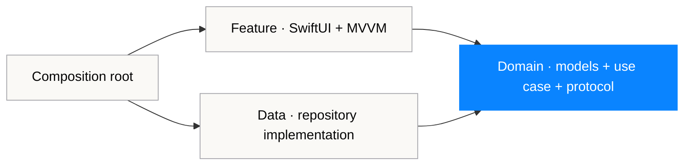

# iOS Architecture Reference


[](Package.swift)
[](Package.swift)
[](https://github.com/magnoscg/ios-architecture-reference/actions/workflows/ci.yml)
[](LICENSE.md)

**[Español](README.es.md)** · **[Architecture](ARCHITECTURE.md)** · **[Decisions](docs/decisions)** · **[Security](SECURITY.md)**

A small, buildable Swift 6 reference for **Clean Architecture + MVVM + typed Router navigation**. It is deliberately narrower than a production app: one vertical slice, four modules, explicit dependency rules and fast tests that run without launching a simulator.

This is an original reference implementation by Oscar Canton. It contains no CholloGas or Hilo product code, credentials, production endpoints or private infrastructure details.

## Recruiter snapshot

| Signal | Evidence |
| --- | --- |
| Architecture | Four Swift Package targets with compile-time dependency direction |
| Modern iOS | Swift 6, SwiftUI, Observation, async/await and `Sendable` boundaries |
| Presentation | Explicit loading/content/empty/failure state and a `@MainActor` view model |
| Navigation | Typed routes owned by an observable Router, outside feature views |
| Delivery | One composition root for demo and live dependency graphs |
| Quality | 15 Swift Testing checks across domain, data and presentation |
| Supply chain | Zero third-party package dependencies and read-only CI permissions |

## What the repository demonstrates



The arrows are dependencies, not runtime calls. `ArchitectureDomain` imports neither SwiftUI nor networking. `ArchitectureData` implements the repository protocol declared by the domain. `ArchitectureFeature` consumes the use case and owns only presentation state. `ArchitectureComposition` is the single place that knows every concrete type.

The runtime path remains equally explicit:

```text
SwiftUI task
  → @MainActor view model
    → domain use case
      → repository protocol
        → actor-isolated remote repository
          → HTTPS client
        ← Sendable domain values
    ← content / empty / failure state
  → typed Router destination
```

## Review it in five minutes

1. Start with [`Package.swift`](Package.swift) to see the module graph.
2. Read [`LoadArchitectureArticles`](Sources/ArchitectureDomain/LoadArchitectureArticles.swift) to see a domain rule without framework dependencies.
3. Compare the protocol with [`RemoteArchitectureArticleRepository`](Sources/ArchitectureData/RemoteArchitectureArticleRepository.swift).
4. Review [`ArchitectureArticleListViewModel`](Sources/ArchitectureFeature/ArchitectureArticleListViewModel.swift) for MainActor state and error translation.
5. Finish at [`ArchitectureReference`](Sources/ArchitectureComposition/ArchitectureReference.swift), where concrete dependencies are assembled once.

## Build and validate

Requirements: Xcode 16 or newer with a Swift 6 toolchain.

```bash
swift test
swift build -c release
./scripts/validate-public-content.sh
```

The package targets iOS 18+ and uses macOS 15+ as a fast test host. Unit tests use Swift Testing and do not require an iOS simulator.

## Use the reference in a thin app shell

Add the package locally, then keep the app target responsible only for platform startup and production configuration:

```swift
import ArchitectureComposition
import SwiftUI

@main
struct ReferenceDemoApp: App {
    var body: some Scene {
        WindowGroup {
            ArchitectureReference.demo()
        }
    }
}
```

`ArchitectureReference.live(baseURL:)` shows the same graph with an HTTPS repository. The demo graph is deterministic and makes previews or exploratory builds independent from a backend.

## Deliberate trade-offs

- This is a reference, not a framework teams should adopt without discussion.
- Four modules make the dependency rule visible; a smaller app may need fewer.
- The Router is useful because navigation is part of the example. Simple leaf views do not need one.
- The network client is actor-isolated, while immutable payloads cross boundaries as `Sendable` values.
- Errors become stable presentation copy at the feature boundary; transport details are not leaked to users.
- No persistence, analytics, authentication or dependency-injection library is added merely to make the diagram larger.

The longer rationale, rejected alternatives and scaling guidance live in [`ARCHITECTURE.md`](ARCHITECTURE.md) and the [architecture decision records](docs/decisions).

## Repository boundary

The sample domain describes architecture articles created for this repository. It is not extracted from a commercial application. Product code, credentials and operational configuration remain outside this repository by design. See [`SECURITY.md`](SECURITY.md) for the public security posture and [`ASSET_PROVENANCE.md`](ASSET_PROVENANCE.md) for brand asset provenance.

---

<a href="https://ogamlabs.com"></a>

Built by [Oscar Canton](https://github.com/magnoscg) · [MIT licence](LICENSE.md)
