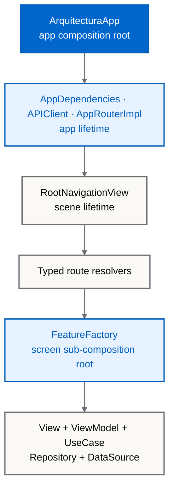
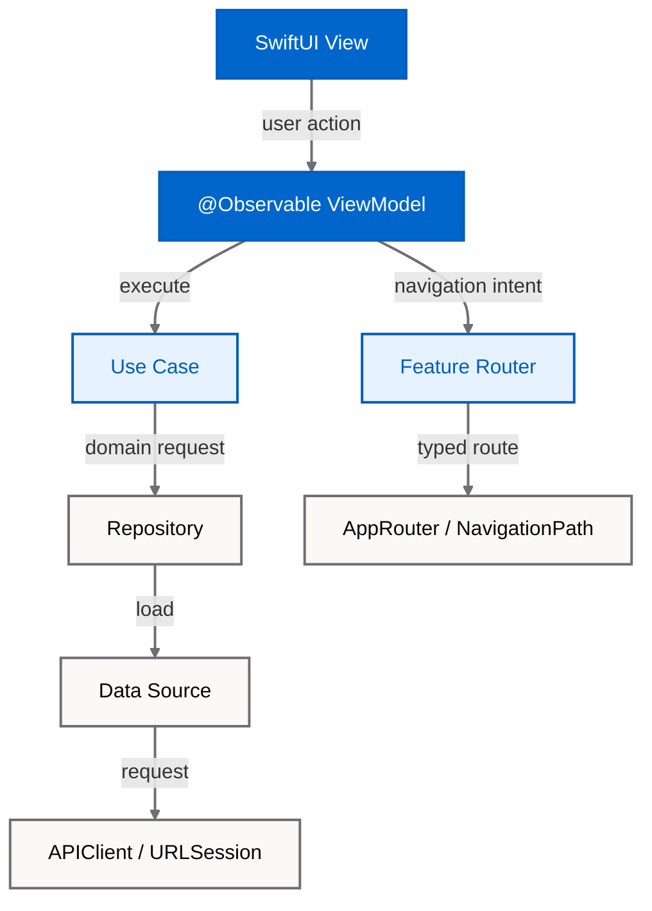

# iOS Architecture Reference


[](Arquitectura.xcodeproj/project.pbxproj)
[](Arquitectura.xcodeproj/project.pbxproj)
[](https://github.com/magnoscg/ios-architecture-reference/actions/workflows/ci.yml)
[](LICENSE.md)

**[Español](README.es.md)** · **[Architecture](ARCHITECTURE.md)** · **[Project structure](docs/PROJECT-STRUCTURE.md)** · **[Known limitations](docs/KNOWN-LIMITATIONS.md)**

A buildable SwiftUI reference application showing the architecture used across Oscar Canton's iOS work: **layered and feature-oriented, inspired by Clean Architecture, with MVVM, typed routing, and manual factory-based dependency injection**.

This is the real reference application, not a diagram-only sample. It is intentionally published without private product code, private repository history, credentials, or operational infrastructure.

## Real app evidence

These captures come from the checked-in `Arquitectura-Dev` app running in an iPhone 17 Pro simulator on iOS 26.5. Each image automatically follows GitHub's light/dark preference; both source variants remain directly reviewable under [`docs/images`](docs/images).

<p align="center">
  <picture>
    <source media="(prefers-color-scheme: dark)" srcset="docs/images/architecture-list-dark.png">
    
  </picture>
  <picture>
    <source media="(prefers-color-scheme: dark)" srcset="docs/images/architecture-detail-dark.png">
    
  </picture>
</p>

The gallery uses the `en_US` locale and contains no Pokémon artwork. Capture conditions and immutable hashes are recorded in [Asset provenance](ASSET_PROVENANCE.md).

## What a reviewer can verify

- **Traceable composition:** [`ArquitecturaApp`](Arquitectura/ArquitecturaApp.swift) creates app-lifetime dependencies; each feature factory creates a screen-lifetime object graph.
- **Complete flows:** SwiftUI View → `@Observable` ViewModel → Use Case → Repository → Data Source → `APIClient`.
- **Typed navigation:** feature-specific route enums delegate to one observable [`AppRouter`](Arquitectura/App/Navigation/AppRouter.swift).
- **Real delivery concerns:** xcconfig environments, URLSession networking, request interceptors, SSL-pinning infrastructure, a privacy manifest, deep links, and route restoration.
- **Test evidence:** the source snapshot verified on 2026-08-04 runs 194 Swift Testing cases across 27 suites. CI derives its current count instead of trusting this sentence.
- **Honest boundaries:** folders express the architecture inside one application target; they do not enforce module boundaries at compile time.

## Composition and lifetimes



Text fallback:

```text
ArquitecturaApp
├── AppDependencies ── APIClient                 [app lifetime]
├── AppRouterImpl                                [app lifetime]
└── RootNavigationView                           [scene lifetime]
    └── typed route resolvers
        └── FeatureFactory                       [screen lifetime]
            └── View · ViewModel · UseCase · Repository · DataSource
```

The application has a **hierarchical composition root**, not one global file that constructs every concrete type. The app root owns shared services and navigation; feature factories are smaller composition roots for individual screens.

## Runtime flow



Text fallback:

```text
View → ViewModel → UseCase → Repository → DataSource → APIClient
          └──────→ FeatureRouter → AppRouter → NavigationPath
```

These arrows show runtime collaboration. Because the app code is compiled into one target, the layer boundaries are conventions backed by review and tests rather than separate Swift modules.

## Review it in five minutes

1. Start at [`ArquitecturaApp`](Arquitectura/ArquitecturaApp.swift) and [`AppDependencies`](Arquitectura/App/Config/AppDependencies.swift) to see app-lifetime construction.
2. Follow [`RootNavigationView`](Arquitectura/App/Navigation/RootNavigationView.swift) into the typed route resolvers.
3. Open [`PokemonListFactory`](Arquitectura/Features/PokemonList/DI/PokemonListFactory.swift) to inspect a complete feature graph.
4. Trace [`PokemonListViewModel`](Arquitectura/Features/PokemonList/Presentation/ViewModels/PokemonListViewModel.swift) → [`PokemonListUseCaseImpl`](Arquitectura/Domain/PokemonList/UseCases/PokemonListUseCaseImpl.swift) → [`PokemonListRepositoryImpl`](Arquitectura/Data/PokemonList/Repositories/PokemonListRepositoryImpl.swift).
5. Compare those contracts with their focused tests under [`ArquitecturaTests`](ArquitecturaTests).

The application also contains a local architecture catalogue with 19 implemented entries. Each detail is backed by real paths in this repository; unsupported concepts were removed instead of being presented as finished work.

## Build and validate

Requirements:

- macOS with the Xcode 26.2 project format. The snapshot was verified locally with Xcode 26.6 and Swift compiler 6.3.3; CI uses the default Xcode selected by GitHub's `macos-26` image.
- An iOS 18+ simulator.
- SwiftFormat and SwiftLint available on `PATH` for lint validation.

```bash
git clone https://github.com/magnoscg/ios-architecture-reference.git
cd ios-architecture-reference
make ci
open Arquitectura.xcodeproj
```

Select the shared `Arquitectura-Dev` scheme and an available iPhone simulator. Development is the only environment validated as runnable in this public reference.

Useful commands:

```bash
make build      # Build Arquitectura-Dev without code signing
make test       # Run the Swift Testing plan on a simulator
make lint       # Check SwiftFormat and SwiftLint without rewriting files
make validate   # Check the public boundary, links and provenance
make format     # Explicitly rewrite Swift formatting
```

## What this repository is — and is not

The project demonstrates architecture through two small domains: a local, self-describing architecture catalogue and a live PokeAPI list/detail flow. It has no third-party Swift package dependencies.

It is **not** strict Clean Architecture, a reusable framework, an offline-first app, or an App Store-ready production target. In particular:

- repository protocols currently live under `Data` even when Domain use cases consume them;
- the single app target cannot prevent cross-layer imports;
- Staging and Production are illustrative templates with placeholder configuration;
- the checked-in test plan contains unit/integration-style Swift Testing suites, not UI tests;
- there is no database or domain-data persistence layer.

See [Known limitations](docs/KNOWN-LIMITATIONS.md) for the complete, prioritized list.

## Documentation map

- [Architecture](ARCHITECTURE.md): boundaries, composition, navigation, state, errors, concurrency, and test strategy.
- [Project structure](docs/PROJECT-STRUCTURE.md): real folder tree and placement guide.
- [Architecture decisions](docs/decisions): current decisions plus the historical v1 records.
- [Source provenance](docs/SOURCE-PROVENANCE.md): reproducible source snapshot and public allowlist.
- [v1 SPM reference](docs/V1-SPM-REFERENCE.md): the preserved package-based reference and migration note.
- [Security](SECURITY.md) and [third-party notices](THIRD_PARTY_NOTICES.md).

## Version and licence boundaries

Version 2 is a breaking change from a four-target Swift Package to this Xcode reference application. The original package remains available at tag [`1.0.0`](https://github.com/magnoscg/ios-architecture-reference/tree/1.0.0).

Repository source code is available under the [MIT License](LICENSE.md). OgamLabs identity assets and third-party names, data, and artwork are outside that code licence; see [asset provenance](ASSET_PROVENANCE.md) and [third-party notices](THIRD_PARTY_NOTICES.md).

---

Built by [Oscar Canton](https://github.com/magnoscg) under the [OgamLabs](https://ogamlabs.com) studio identity.

**Document Metadata**

| Field | Value |
| --- | --- |
| Author / Owner | magnoscg / OgamLabs |
| Last Updated | 2026-08-04 |
| Last Verified | 2026-08-04 |
| Status | Verified for the v2 source snapshot |
| Review Schedule | Quarterly and on architectural change |
| Labels | `ios`, `swiftui`, `architecture`, `reference` |
