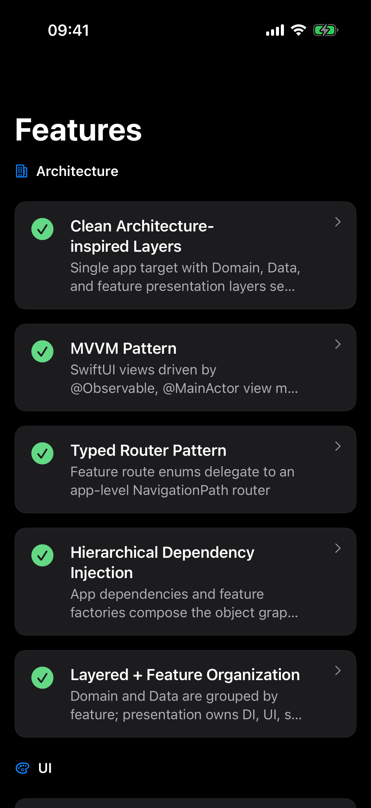
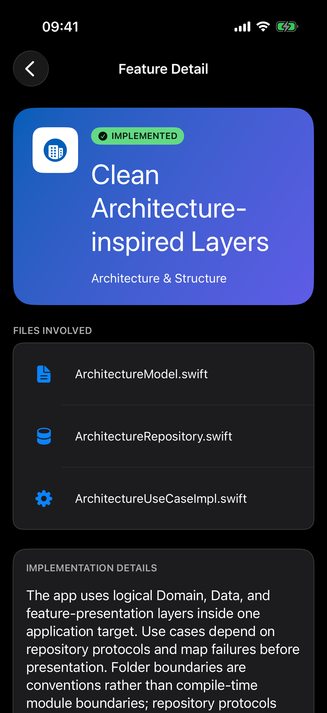
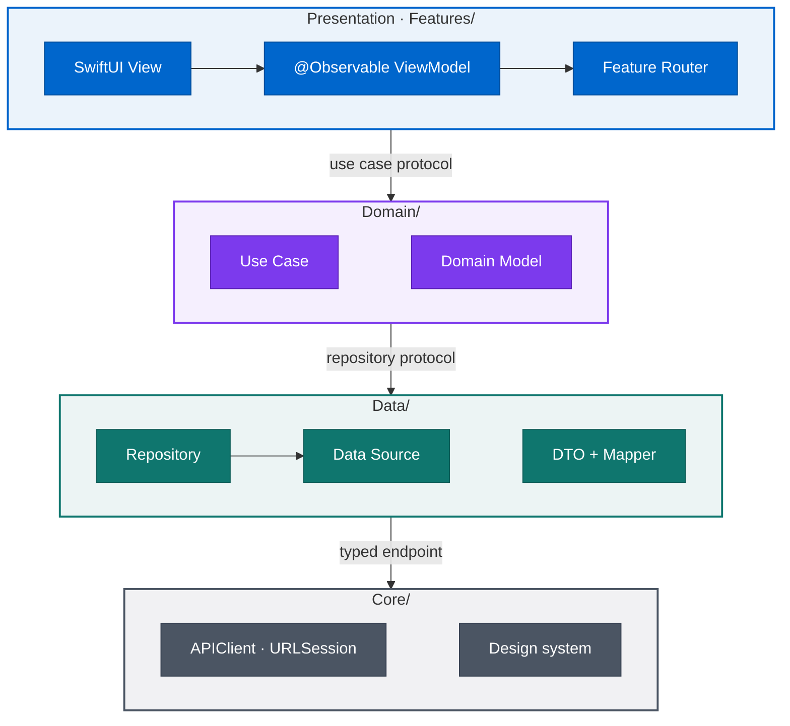
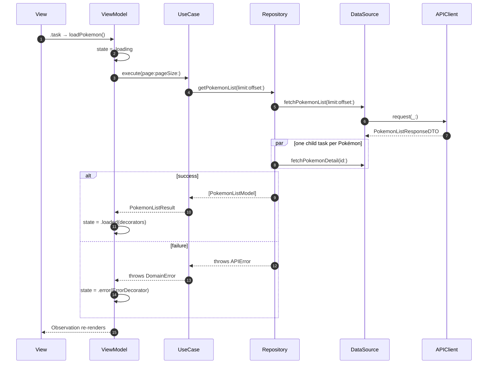
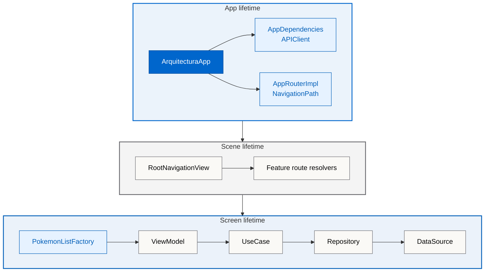

<div align="center">


**A real, buildable SwiftUI app that shows how I structure iOS projects:**<br>
**layered architecture, MVVM, typed navigation and hand-wired dependency injection, in Swift 6.**

[](Arquitectura.xcodeproj/project.pbxproj)
[](Arquitectura.xcodeproj/project.pbxproj)
[](Arquitectura/Features)
[](ArquitecturaTests)
[](https://github.com/magnoscg/ios-architecture-reference/actions/workflows/ci.yml)
[](Arquitectura.xcodeproj/project.pbxproj)
[](LICENSE.md)

[**Architecture**](#-architecture) · [**Life of a request**](#-life-of-a-request) · [**Design decisions**](#-design-decisions) · [**Run it**](#-getting-started) · [**About me**](#-about-me) · [**Español**](README.es.md)

</div>

## ✨ Highlights

<table>
<tr>
<td width="33%" valign="top">

**🧱 Layered, feature-first**

`Domain`, `Data` and `Features` are split per feature, and mappers guard every boundary: DTO → model → UI decorator.

</td>
<td width="33%" valign="top">

**🧭 Typed navigation**

Each feature owns a `Codable` route enum. One `NavigationPath` drives the app, with deep links and state restoration.

</td>
<td width="33%" valign="top">

**🧩 DI without a container**

App-wide services plus one factory per screen. Every object graph reads top to bottom and is checked by the compiler.

</td>
</tr>
<tr>
<td width="33%" valign="top">

**⚡ Swift 6 concurrency**

Swift 6 language mode, `@MainActor` ViewModels, task groups, `async let`, and cancellation that is never swallowed.

</td>
<td width="33%" valign="top">

**🧪 194 tests**

27 Swift Testing suites mirror the source tree: mappers, repositories, use cases, ViewModels and navigation.

</td>
<td width="33%" valign="top">

**📦 Zero dependencies**

Apple frameworks only, including a `URLSession` client with an interceptor chain, retry with backoff and SSL-pinning support.

</td>
</tr>
</table>

## 📱 The app

<p align="center">
  
  
  
  
</p>

The app documents itself. An in-app catalogue explains **19 patterns** (architecture, UI, networking, security and testing), and each one points to the real files that implement it. A second flow talks to **[PokeAPI](https://pokeapi.co)**: a paginated list with infinite scroll and a detail screen that exercise networking, concurrency and error handling end to end. Light and dark mode, English and Spanish.

## 🧱 Architecture

The project is **layered globally and organised by feature locally**. Each layer talks to the next one through a protocol, so Views never see a repository and ViewModels never see a DTO.



| Layer | Responsibility | Example |
| --- | --- | --- |
| **App** | Startup, composition root, navigation stack and deep links | [`ArquitecturaApp`](Arquitectura/ArquitecturaApp.swift) |
| **Features** | SwiftUI views, state enums, ViewModels, UI mappers, routers and factories | [`PokemonListViewModel`](Arquitectura/Features/PokemonList/Presentation/ViewModels/PokemonListViewModel.swift) |
| **Domain** | Business models and use cases | [`PokemonListUseCaseImpl`](Arquitectura/Domain/PokemonList/UseCases/PokemonListUseCaseImpl.swift) |
| **Data** | Repositories, data sources, DTOs and DTO mappers | [`PokemonListRepositoryImpl`](Arquitectura/Data/PokemonList/Repositories/PokemonListRepositoryImpl.swift) |
| **Core** | Networking, security helpers, design system and shared components | [`APIClientImpl`](Arquitectura/Core/Networking/APIClientImpl.swift) |

Data is translated at every boundary (`DTO → model` in Data, `model → decorator` in Presentation) and errors travel the same way: `APIError → DomainError → ErrorDecorator`. Raw server payloads never reach the UI.

## 🔄 Life of a request

What happens when the Pokémon list opens:



Details are fetched in parallel with a task group. A single failed detail is logged and skipped so it cannot break the page, while cancellation always propagates.

## 🧩 Inside a feature

Every feature follows the same shape, so a new screen is predictable to build and easy to review:

```text
Features/PokemonList/
├── DI/PokemonListFactory.swift            builds the screen's object graph
├── Navigation/
│   ├── PokemonListRouter.swift            route enum + router protocol + impl
│   └── PokemonListRouteResolver.swift     route → destination view
├── Presentation/
│   ├── Mappers/                           domain model → UI decorator
│   └── ViewModels/PokemonListViewModel.swift
└── UI/
    ├── PokemonListView.swift
    ├── PokemonListState.swift             idle · loading · loaded · error
    ├── PokemonListDecorator.swift
    └── Components/
Domain/PokemonList/                        Models/ · UseCases/
Data/PokemonList/                          Repositories/ · DataSources/ · DTO/ · Mappers/
```

Each screen renders one explicit state, so impossible combinations cannot be expressed:

```swift
enum PokemonListState: Equatable {
    case idle
    case loading
    case loaded([PokemonListItemDecorator])
    case error(ErrorDecorator)
}
```

**Dependency injection is manual and hierarchical.** The app root creates long-lived services once; each screen's factory assembles its own graph through constructor injection. No container, no service locator, no singletons.



<details>
<summary><b>See the factory</b></summary>

From [`PokemonListFactory.swift`](Arquitectura/Features/PokemonList/DI/PokemonListFactory.swift):

```swift
static func makeView(appRouter: AppRouter, dependencies: AppDependencies) -> PokemonListView {
    let router = makeRouter(appRouter: appRouter)
    let viewModel = makeViewModel(router: router, apiClient: dependencies.apiClient)
    return PokemonListView(viewModel: viewModel)
}

static func makeRepository(apiClient: APIClient) -> PokemonListRepository {
    PokemonListRepositoryImpl(remoteDataSource: makeRemoteDataSource(apiClient: apiClient),
                              dtoMapper: makeDTOMapper())
}

static func makeUseCase(apiClient: APIClient) -> PokemonListUseCase {
    PokemonListUseCaseImpl(repository: makeRepository(apiClient: apiClient))
}

static func makeViewModel(router: PokemonListRouter, apiClient: APIClient) -> PokemonListViewModel {
    PokemonListViewModel(useCase: makeUseCase(apiClient: apiClient),
                         decoratorMapper: makeDecoratorMapper(),
                         router: router)
}
```

</details>

## 🧭 Navigation

Feature views and ViewModels never build screens or touch the navigation path. Each feature declares its routes as a `Codable` enum behind a small router protocol, so a ViewModel only expresses intent:

```swift
enum PokemonListRoute: Hashable, Codable {
    case list
    case detail(pokemonId: Int)
}

@MainActor
protocol PokemonListRouter: Sendable {
    func navigateToDetail(pokemonId: Int)
    func goBack()
}
```

A single `NavigationStack` owns the path, and every feature plugs in its destinations with a resolver modifier:

```swift
NavigationStack(path: $appRouter.path) {
    ArchitectureFactory.makeView(appRouter: appRouter)
        .withArchitectureRoutes(appRouter: appRouter)
        .withPokemonListRoutes(appRouter: appRouter, dependencies: dependencies)
}
.onOpenURL { url in
    coordinator.handleDeepLink(url)
}
```

Because routes are `Codable`, the path is saved with `@SceneStorage` (debounced) and restored on relaunch, and `arquitectura://` deep links map straight onto typed routes.

## ⚡ Concurrency and errors

- **Swift 6 language mode** with `MainActor` as the default isolation; contracts that cross task boundaries are `Sendable`.
- **Structured concurrency**: the list fetches details in parallel with `withThrowingTaskGroup`, and the detail screen loads data and species together with `async let`.
- **Cancellation is a real code path**: use cases and repositories rethrow `CancellationError`, and ViewModels restore their previous state instead of getting stuck on a spinner.
- **Resilient pagination**: infinite scroll keeps loaded content on screen and shows a retryable banner when the next page fails.

<details>
<summary><b>See how a ViewModel loads its state</b></summary>

From [`PokemonListViewModel.swift`](Arquitectura/Features/PokemonList/Presentation/ViewModels/PokemonListViewModel.swift):

```swift
func loadPokemon() async {
    switch state {
    case .loading, .loaded: return
    case .idle, .error: break
    }

    let previousState = state
    state = .loading
    currentPage = 0
    hasMore = true
    allItems = []

    do {
        let result = try await useCase.execute(page: 0, pageSize: pageSize)
        let items = decoratorMapper.mapToItems(result.pokemon)
        allItems = items
        hasMore = result.hasMore
        currentPage = 1
        state = .loaded(items)
    } catch is CancellationError {
        state = previousState
    } catch let error as DomainError {
        state = .error(ErrorDecorator.from(error))
    } catch {
        state = .error(.generic)
    }
}
```

</details>

## 🧪 Testing

**194 tests in 27 suites**, written with Swift Testing and organised like the app itself (`App`, `Core`, `Domain`, `Data`, `Features`). Every collaborator sits behind a protocol, so each layer is tested in isolation with lightweight mocks:

```swift
@Test("loadPokemon restores previous state on CancellationError")
func loadPokemonRestoresPreviousStateOnCancellation() async {
    let mockUseCase = MockPokemonListUseCase()
    await mockUseCase.setExecuteResult(.failure(CancellationError()))
    let (viewModel, _, _) = makeSUT(useCase: mockUseCase)

    await viewModel.loadPokemon()

    #expect(viewModel.state == .idle)
}
```

The suites cover endpoints and interceptors, DTO and decorator mappers, repositories and data sources, use-case pagination, sorting, error mapping and cancellation, ViewModel state transitions, router delegation, and navigation encoding, restoration and deep-link parsing.

[GitHub Actions](https://github.com/magnoscg/ios-architecture-reference/actions/workflows/ci.yml) runs on pushes and pull requests: content validation → SwiftFormat and strict SwiftLint → build → tests → a clean-diff check.

## 🧠 Design decisions

Architecture is a set of trade-offs, so the important ones are written down:

| Decision | Why | Cost I accept |
| --- | --- | --- |
| **One app target with logical layers** · [ADR-0004](docs/decisions/0004-single-app-target-logical-boundaries.md) | Easy to open, build and navigate; modules come when build times or team ownership justify them | Layer rules are enforced by convention, review and tests rather than by the compiler |
| **Hand-written, hierarchical composition roots** · [ADR-0005](docs/decisions/0005-hierarchical-composition-roots.md) | Explicit lifetimes and compiler-checked object graphs, with no DI framework | A few more lines per feature |
| **Typed feature routes behind one app router** · [ADR-0006](docs/decisions/0006-typed-feature-routing.md) | ViewModels stay testable and unaware of SwiftUI navigation; `Codable` routes enable restoration and deep links | A shared `NavigationPath` needs a migration plan if stored routes change |
| **`@MainActor @Observable` ViewModels with explicit state enums** | Predictable UI state with no Combine, and transitions that are easy to test | Work stays on the main actor unless it is explicitly moved off it |

Every known shortcut, including where this deliberately stops short of strict Clean Architecture, is listed in [Known limitations](docs/KNOWN-LIMITATIONS.md).

## 🧰 Tech stack

| Area | What it uses |
| --- | --- |
| Language and UI | Swift 6 · SwiftUI · Observation (`@Observable`) |
| Navigation | `NavigationStack` · typed `Codable` routes · deep links · `@SceneStorage` restoration |
| Networking | `URLSession` · typed endpoints · logging and retry interceptors · SSL-pinning delegate · `NWPathMonitor` |
| Security and privacy | Keychain helper · privacy manifest |
| Localization | String Catalog in English and Spanish |
| Configuration | `.xcconfig` environments with Development, Staging and Production schemes |
| Quality | Swift Testing · SwiftLint · SwiftFormat · GitHub Actions |
| Dependencies | None: Apple frameworks only |

## 🚀 Getting started

**Requirements:** Xcode 26, an iOS 18+ simulator, and SwiftLint and SwiftFormat for linting (`brew install swiftlint swiftformat`).

```bash
git clone https://github.com/magnoscg/ios-architecture-reference.git
cd ios-architecture-reference
open Arquitectura.xcodeproj
```

Run the **Arquitectura-Dev** scheme on any iPhone simulator. From the terminal:

| Command | What it does |
| --- | --- |
| `make build` | Builds the Development app without code signing |
| `make test` | Runs the Swift Testing plan on a simulator |
| `make lint` | Checks SwiftFormat and SwiftLint without touching files |
| `make validate` | Checks documentation links, assets and the public boundary |
| `make ci` | Runs everything CI runs, in order |

<details>
<summary><b>Project structure</b></summary>

```text
Arquitectura/
├── ArquitecturaApp.swift      app entry point and composition root
├── App/                       configuration, navigation and splash screen
├── Core/                      networking, security, design system, shared UI
├── Domain/                    models and use cases, per feature
├── Data/                      repositories, data sources and DTOs, per feature
├── Features/                  screens: UI, ViewModels, routers and factories
└── Resources/                 assets, catalogue data and String Catalog
ArquitecturaTests/             Swift Testing suites that mirror the app layers
docs/                          architecture decisions and guides
```

[Project structure](docs/PROJECT-STRUCTURE.md) has the full tree and explains where each new file belongs.

</details>

## 📚 Documentation

- [Architecture deep dive](ARCHITECTURE.md): boundaries, composition, navigation, state, errors and concurrency
- [Project structure](docs/PROJECT-STRUCTURE.md): folder tree and placement guide
- [Architecture decision records](docs/decisions)
- [Known limitations](docs/KNOWN-LIMITATIONS.md): deliberate trade-offs and what a larger product would change
- [Changelog](CHANGELOG.md) · [Source provenance](docs/SOURCE-PROVENANCE.md) · [Security](SECURITY.md) · [Third-party notices](THIRD_PARTY_NOTICES.md)

## 📅 Project history

| When | Milestone |
| --- | --- |
| **January 2026** | Work starts in my private architecture workspace: conventions, documentation and this reference app |
| **March 2026** | The app becomes the example project of [AnvilCLI](https://github.com/magnoscg/anvil), my Go CLI that scaffolds iOS projects with this architecture |
| **August 2026** | Published here as a clean public snapshot, release `2.0.0` |

The private history was not carried over, which is why every commit in this repository is dated August 2026. [Source provenance](docs/SOURCE-PROVENANCE.md) records the exact snapshot it came from.

## 👋 About me

<a href="https://ogamlabs.com"></a>

I'm **Oscar Canton**, a Senior iOS Engineer based in Madrid. I lead an iOS team by day and build my own apps under **OgamLabs**. This repository shows how I like to work: simple designs, decisions written down with their cost, and tests that protect behaviour.

[Portfolio](https://ogamlabs.com) · [LinkedIn](https://www.linkedin.com/in/oscarcantongarcia/) · [GitHub](https://github.com/magnoscg) · [Email](mailto:soporte@ogamlabs.com)

More of my work: [CholloGas case study](https://github.com/magnoscg/chollogas-case-study) · [Hilo case study](https://github.com/magnoscg/hilo-case-study) · [AnvilCLI](https://github.com/magnoscg/anvil)

## 📄 License

The code is released under the [MIT License](LICENSE.md). OgamLabs brand assets and third-party names, data and artwork are not covered; see [Asset provenance](ASSET_PROVENANCE.md) and [Third-party notices](THIRD_PARTY_NOTICES.md).
